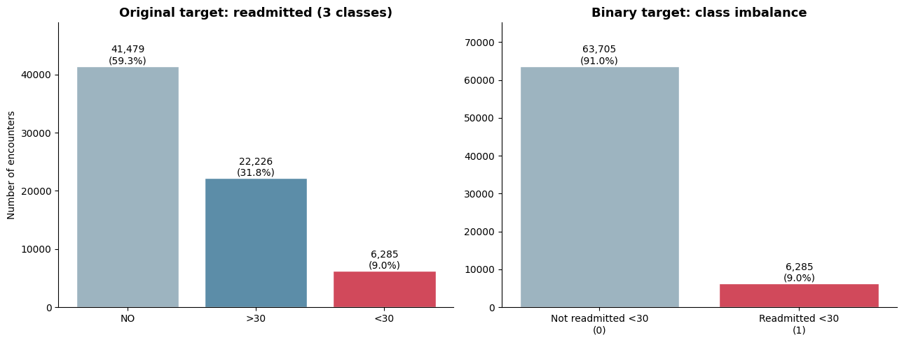
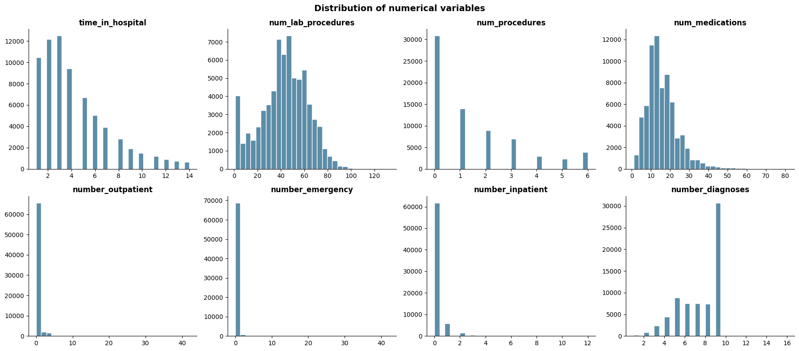
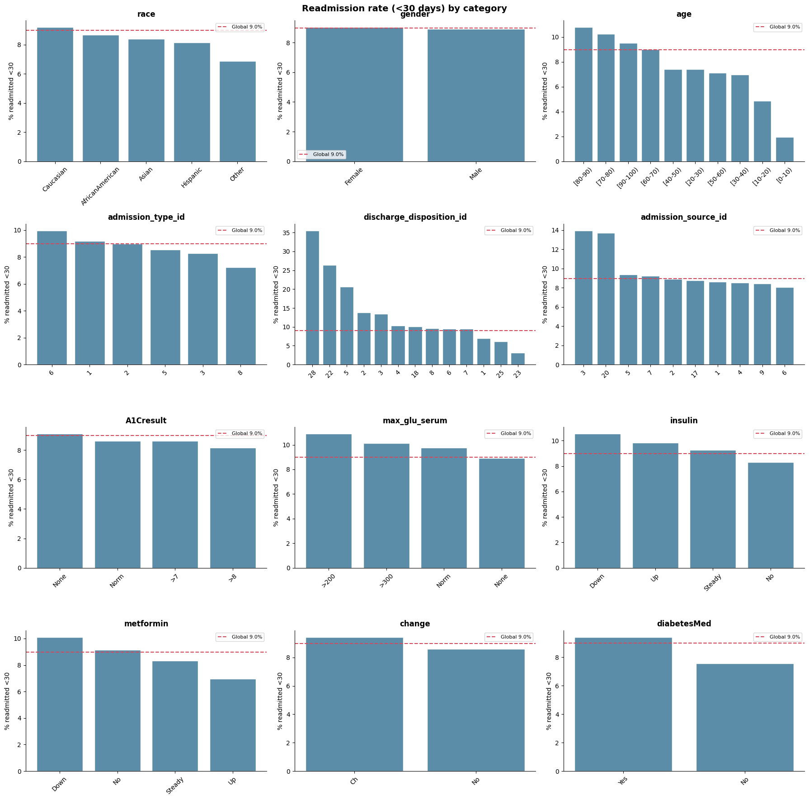
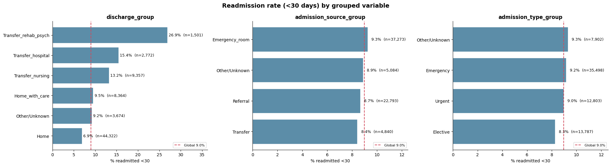
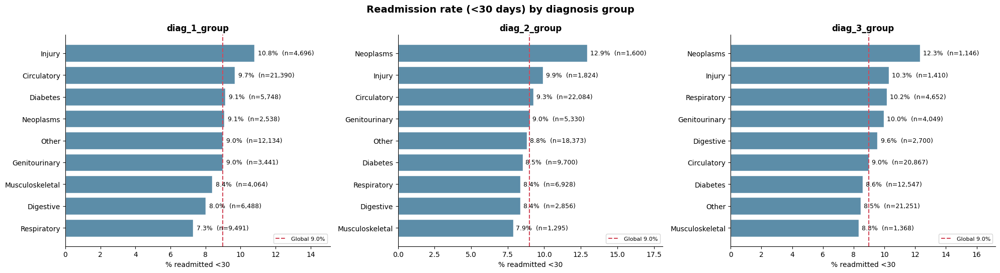
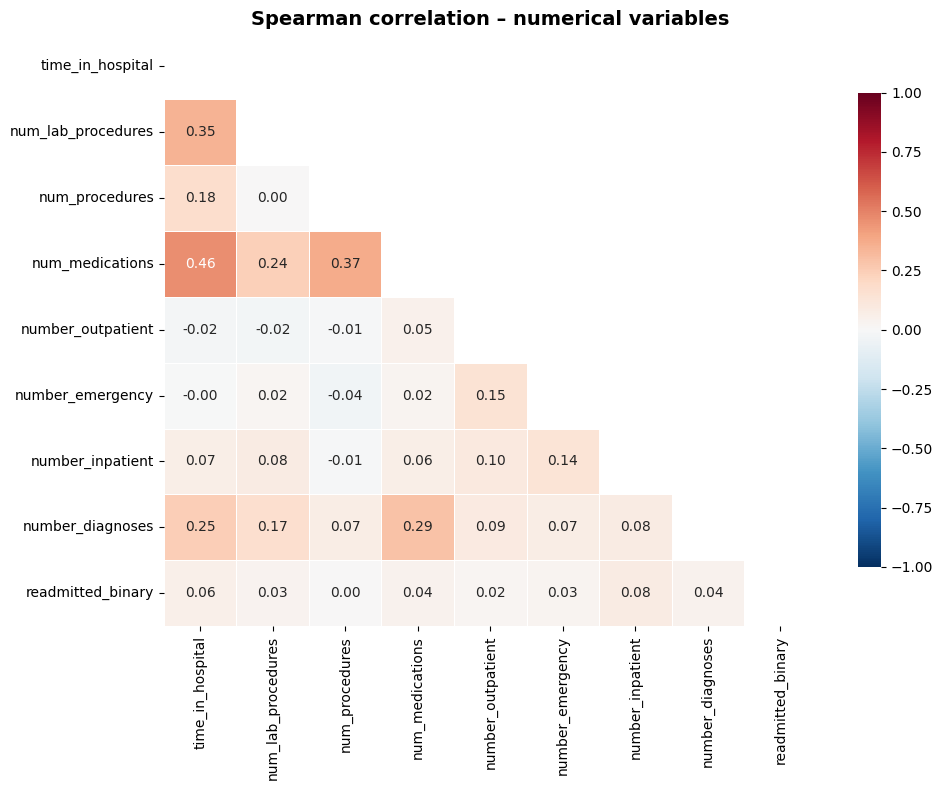
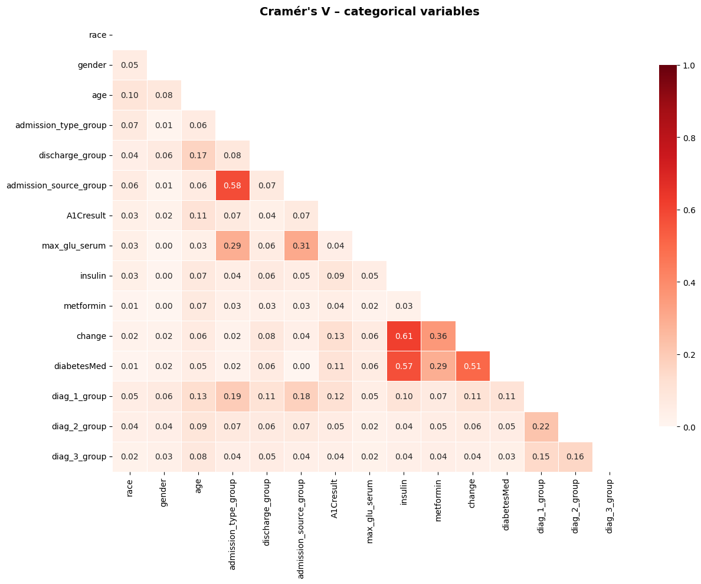
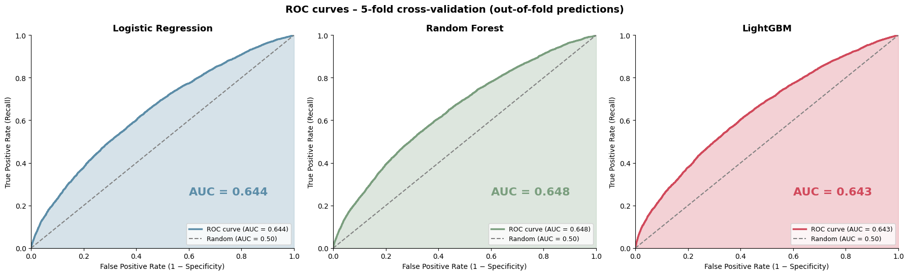

# Early Hospital Readmission Risk in Diabetic Patients

Predicting which diabetic patients are at higher risk of being **readmitted within 30 days of discharge**, using 10 years of clinical records from 130 US hospitals.

---

## Business problem

Early readmissions are costly for hospitals and are often a sign of inadequate care or follow-up after discharge. In diabetic patients, poor management increases both hospital costs and the risk of complications, morbidity and mortality.

**Business question:** *Which patients have the highest risk of being readmitted within 30 days?*

Identifying them at discharge allows the hospital to focus follow-up resources (calls, early visits, medication review) on the patients who need them most.

---

## Dataset

- **Source:** [Diabetes 130-US Hospitals for Years 1999–2008](https://archive.ics.uci.edu/dataset/296/diabetes+130-us+hospitals+for+years+1999-2008), UCI Machine Learning Repository (CC BY 4.0)
- **Size:** 101,766 hospital encounters, 71,518 unique patients, 50 variables
- **Content:** demographics, admission and discharge information, length of stay, procedures, number of medications, prior visits, diagnoses (ICD-9 codes), lab results and diabetes medications
- **Target:** `readmitted` (`<30`, `>30`, `NO`)
- **Auxiliary file:** `IDS_mapping.csv`, with descriptions of the admission type, admission source and discharge disposition codes

---

## Methodology

### 1. Data cleaning
- Missing values are encoded as `?` in the raw file and were converted to `NaN`. The `None` value in `A1Cresult` and `max_glu_serum` means "not measured" and was kept as a category.
- Columns with a high share of missing values were removed: `weight` (97%), `medical_specialty` (49%) and `payer_code` (40%).
- Low-variance medication columns (dominant value "No" in more than 85% of records) were removed.
- **2,423 encounters** of patients who died or were discharged to hospice were excluded, since they cannot be readmitted.

### 2. Target and repeated patients
- **Binary target:** `<30` = 1, `>30` + `NO` = 0.
- Many patients appear several times (16,341 patients with more than one encounter, up to 40). To avoid data leakage between train and test, **only the first encounter per patient was kept**, ordering by `encounter_id` as a proxy for time. The last encounter was not used because it is biased toward "no readmission".
- **Final dataset:** 69,990 patients, with **9.0% positive class** (imbalanced: about 1 in 10).



### 3. Exploratory data analysis
- Distributions of numerical variables: prior-visit variables (`number_inpatient`, `number_emergency`, `number_outpatient`) are highly skewed, with most values at 0. `number_diagnoses` is capped at 9 for many records.
- Readmission rate (<30 days) by category for every categorical variable, compared with the global rate.





### 4. Feature engineering
- **ID variables** (`admission_type_id`, `discharge_disposition_id`, `admission_source_id`) were grouped into a few interpretable categories using the mapping file, keeping groups with different readmission rates separate.
- **Diagnoses** (`diag_1`, `diag_2`, `diag_3`, hundreds of ICD-9 codes) were grouped into 9 clinical categories: Circulatory, Respiratory, Digestive, Diabetes, Injury, Musculoskeletal, Genitourinary, Neoplasms and Other.
- `age` was converted from ranges (`[70-80)`) to an ordinal numeric value.





### 5. Correlation analysis and feature selection
| Analysis | Method | Purpose |
|---|---|---|
| Numerical vs. numerical | Spearman correlation | Detect multicollinearity |
| Categorical vs. categorical | Cramér's V (bias-corrected) | Detect redundant variables |
| Categorical vs. target | Chi-square test + Cramér's V | Rank variables by association with readmission |

Main results:
- No strong correlations among numerical variables (max ρ = 0.46, `time_in_hospital` vs. `num_medications`).
- `change`, `insulin` and `diabetesMed` are redundant (V = 0.51–0.61); only `insulin` was kept.
- `gender`, `A1Cresult` and `max_glu_serum` show no significant association with the target.





**The original 50 variables were reduced to 13 predictors:**

| Numerical (7) | Categorical (6) |
|---|---|
| time_in_hospital | discharge_group |
| num_lab_procedures | age (ordinal) |
| num_medications | insulin |
| number_outpatient | diag_1_group |
| number_emergency | diag_2_group |
| number_inpatient | diag_3_group |
| number_diagnoses | |

### 6. Modeling
- Stratified train/test split (80/20). The test set was used only once, for the final evaluation.
- Three models, each in a scikit-learn `Pipeline`:
  - **Logistic Regression**: `log1p` on prior-visit variables, standardization, one-hot encoding
  - **Random Forest**: one-hot encoding, `min_samples_leaf=50`
  - **LightGBM**: one-hot encoding, low learning rate and subsampling
- **Class imbalance:** handled with `class_weight='balanced'` (no synthetic oversampling).
- **Validation:** 5-fold stratified cross-validation on the training set.
- **Decision threshold:** chosen using out-of-fold predictions on the training set, not on the test set.

---

## Results

### Model comparison (5-fold cross-validation)

| Model | ROC-AUC | PR-AUC |
|---|---|---|
| Logistic Regression | 0.645 ± 0.012 | 0.161 ± 0.007 |
| Random Forest | 0.649 ± 0.011 | 0.165 ± 0.006 |
| LightGBM | 0.643 ± 0.013 | 0.167 ± 0.007 |

The three models perform the same: the differences are smaller than the variability between folds. **Logistic Regression was selected** for its simplicity and interpretability.



### Final evaluation on the test set (Logistic Regression, threshold = 0.55)

| Metric | Value |
|---|---|
| ROC-AUC | 0.647 |
| PR-AUC | 0.167 (random baseline: 0.09) |
| Recall | 0.418 |
| Precision | 0.154 |
| Specificity | 0.774 |
| F1 | 0.225 |

Confusion matrix: TP = 526, FP = 2,883, FN = 731, TN = 9,858.

Test results are almost identical to cross-validation, so the model is **not overfitted**.

### Business interpretation
- The model flags **24% of patients** as high risk.
- That group contains **42% of all 30-day readmissions**.
- Among flagged patients, the readmission rate is **15.4%**, about **1.7 times** the 9% average.

With the same follow-up effort, a hospital using the model would reach almost **twice as many readmissions** as with a random selection of patients. The threshold can be lowered to detect more readmissions, at the cost of flagging more patients.

---

## Key findings

1. **Discharge disposition is the strongest predictor.** Patients transferred to a rehabilitation or psychiatric facility (27%), another hospital (15%) or a nursing facility (13%) are readmitted far more often than those discharged home (7%).
2. **Prior hospitalizations matter.** Readmitted patients had, on average, more than twice as many inpatient visits in the previous year (0.37 vs. 0.16).
3. **Risk increases with age**, from about 2% in patients under 10 to 11% in patients aged 80–90.
4. **Insulin dose adjustments** (Up/Down) are associated with higher risk, suggesting less stable patients.
5. **All three algorithms hit the same ceiling (AUC ≈ 0.65).** The limitation is in the available information, not in the choice of model.

---

## Limitations and next steps

**Limitations**
- The dataset lacks information that drives many readmissions: clinical severity, vital signs and lab values at discharge, social factors (living alone, access to medication) and post-discharge follow-up.
- There are no dates; `encounter_id` was used as a proxy for time order.
- The data covers 1999–2008, so clinical practices may have changed since then.

**Next steps**
- Risk table by deciles to present the model as a risk ranking.
- Interpretation of the Logistic Regression coefficients and SHAP values for LightGBM.
- Probability calibration.
- New features (e.g., total prior visits) and a grouped version of `medical_specialty`.

---

## Project structure

```
├── README.md
├── riesgoHospitalario.ipynb   # Full analysis: cleaning, EDA, feature selection, modeling, evaluation
├── requirements.txt
├── data/
│   ├── diabetic_data.csv      # Raw dataset (UCI)
│   └── IDS_mapping.csv        # Code descriptions for ID variables
└── images/                    # Charts exported from the notebook
    ├── 01_target_distribution.png
    ├── 02_numerical_distributions.png
    ├── 03_spearman_correlation.png
    ├── 04_readmission_rate_by_category.png
    ├── 05_grouped_variables.png
    ├── 06_diagnosis_groups.png
    ├── 07_cramers_v.png
    └── 08_roc_curves.png
```

---

## How to run

The notebook was developed in **Google Colab** and reads the data from Google Drive.

1. Clone the repository:
   ```bash
   git clone <repository-url>
   ```
2. Install the dependencies:
   ```bash
   pip install -r requirements.txt
   ```
3. Open `riesgoHospitalario.ipynb` and update `base_path` in the first code cell to point to the `data/` folder. When running outside Colab, remove the Google Drive mount lines.

---

## Tools

Python · pandas · NumPy · scikit-learn · LightGBM · SciPy · Matplotlib · Seaborn · Google Colab

---

## References

- Strack, B. et al. (2014). *Impact of HbA1c Measurement on Hospital Readmission Rates: Analysis of 70,000 Clinical Database Patient Records.* BioMed Research International.
- UCI Machine Learning Repository: Diabetes 130-US Hospitals for Years 1999–2008.
